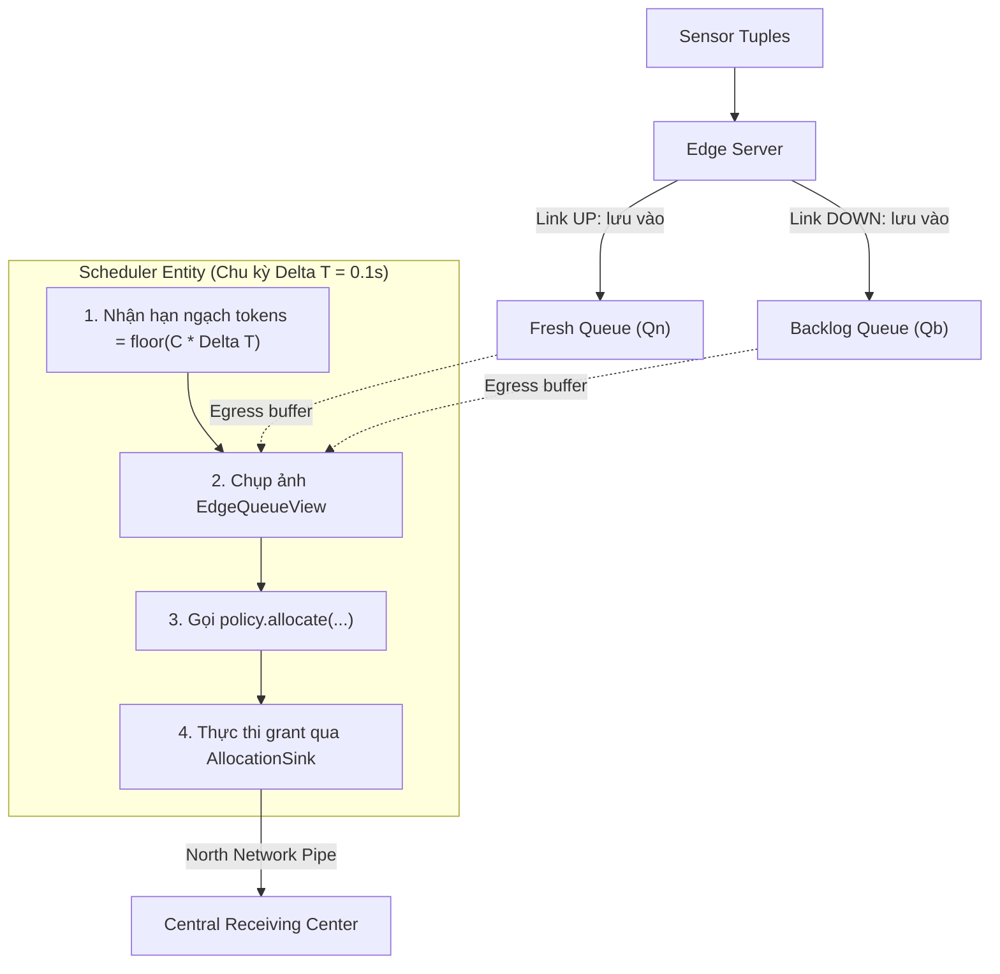

# Hướng dẫn Thêm Chính sách Lập lịch Mới (Adding a New Policy)

Tài liệu này hướng dẫn chi tiết quy trình phát triển, tích hợp, cấu hình và kiểm thử một chính sách lập lịch dữ liệu bù (backfill scheduling policy) mới vào framework mô phỏng **iFogSim2**.

---

## Mục lục
1. [Tổng quan kiến trúc Lập lịch Backfill](#1-tổng-quan-kiến-trúc-lập-lịch-backfill)
2. [Interface `SchedulingPolicy` & Hợp đồng Lập lịch](#2-interface-schedulingpolicy--hợp-đồng-lập-lịch)
3. [Các quy tắc bất biến bắt buộc (Core Invariants)](#3-các-quy-tắc-bất-biến-bắt-buộc-core-invariants)
4. [Hướng dẫn thêm chính sách mới:](#4-hướng-dẫn-thêm-chính-sách-mới)
   - [Bước 1: Hiện thực interface `SchedulingPolicy`](#bước-1-hiện-thực-interface-schedulingpolicy)
   - [Bước 2: Đăng ký chính sách vào hệ thống](#bước-2-đăng-ký-chính-sách-vào-hệ-thống)
   - [Bước 3: (Tùy chọn) Khai báo tham số cấu hình (Knobs)](#bước-3-tùy-chọn-khai-báo-tham-số-cấu-hình-knobs)
   - [Bước 4: (Tùy chọn) Tích hợp vào Script Phân tích Dữ liệu (`analysis/analyze.py`)](#bước-4-tùy-chọn-tích-hợp-vào-script-phân-tích-dữ-liệu-analysisanalyzepy)
   - [Bước 5: (Tùy chọn) Tích hợp giao diện Web Visualizer](#bước-5-tùy-chọn-tích-hợp-giao-diện-web-visualizer)
5. [Mã nguồn mẫu chính sách hoàn chỉnh](#5-mã-nguồn-mẫu-chính-sách-hoàn-chỉnh)
6. [Quy trình Kiểm thử và Xác thực (Verification)](#6-quy-trình-kiểm-thử-và-xác-thực-verification)
7. [Các lỗi thường gặp và cách khắc phục (Troubleshooting)](#7-các-lỗi-thường-gặp-và-cách-khắc-phục-troubleshooting)

---

## 1. Tổng quan kiến trúc Lập lịch Backfill

Hệ thống mô phỏng một mô hình truyền dữ liệu từ $N$ máy chủ biên (Edge Servers) về một trung tâm tiếp nhận duy nhất (Central Receiving Center) qua đường truyền có băng thông giới hạn $C$ (đơn vị: gói tin/giây).



### Nguyên tắc phân tách trách nhiệm (Decoupling):
- **SchedulingPolicy là "Người ra quyết định thuần túy" (Pure Decision-Maker):** Không sở hữu hàng đợi thực, không can thiệp vào cơ chế gửi nhận mạng của iFogSim2, không thao tác event queue và không sinh số ngẫu nhiên ngầm.
- **Tính công bằng tuyệt đối (Fair Comparison):** Khi so sánh các chính sách trong cùng một kịch bản và `seed`, mọi chính sách đều nhận được chuỗi dữ liệu phát sinh (Poisson process) và chuỗi sự cố mất kết nối (Outage timeline) **hoàn toàn giống nhau từng tick**.

---

## 2. Interface `SchedulingPolicy` & Hợp đồng Lập lịch

Tất cả các chính sách nằm tại thư mục: `sim/src/backfill/policy/`.

Interface cốt lõi bao gồm các phương thức:

```java
package backfill.policy;

import java.util.List;
import backfill.SimParams;

public interface SchedulingPolicy {
    /** Khóa định danh duy nhất (dùng trong CLI, tên file kết quả CSV và web demo). VD: "fifo", "rr", "largest". */
    String key();

    /** Tên hiển thị thân thiện trên bảng biểu và đồ thị. */
    String displayName();

    /** Mô tả ngắn gọn ngữ nghĩa phân bổ của chính sách. */
    String description();

    /**
     * Phương thức phân bổ hạn ngạch mỗi chu kỳ tick:
     * @param now Thời điểm mô phỏng hiện tại (giây).
     * @param tokens Ngân sách gói tin trung tâm có thể hấp thụ trong tick này: floor(C * ΔT).
     * @param edges Danh sách góc nhìn (view) hàng đợi bất biến của từng edge server.
     * @param sink Kênh thực thi quyết định grant (chuyển đơn vị dữ liệu đi).
     * @param params Tham số cấu hình mô phỏng bất biến.
     */
    void allocate(double now, double tokens, List<EdgeQueueView> edges, AllocationSink sink, SimParams params);
}
```

### Các đối tượng tương tác:
1. **`EdgeQueueView`**: Cung cấp ảnh chụp trạng thái hàng đợi của một edge server:
   - `int edgeIndex()`: Chỉ số định danh của edge server ($0 \le i < N$).
   - `boolean connected()`: Trạng thái đường truyền. `true` = đang online, `false` = đang đứt kết nối. **Tuyệt đối không cấp phát khi `connected() == false`!**
   - `int newCount()`: Số gói tin mới (sinh khi link UP) đang chờ.
   - `int backCount()`: Số gói tin bù backlog (sinh khi link DOWN) đang chờ.
   - `Double newHeadGenTime()`: Thời điểm phát sinh của gói tin ở đầu hàng đợi mới (`null` nếu rỗng).
   - `Double backHeadGenTime()`: Thời điểm phát sinh của gói tin ở đầu hàng đợi backlog (`null` nếu rỗng).
   - `boolean hasAny()`: Trả về `true` nếu `newCount() + backCount() > 0`.

2. **`AllocationSink`**: Kênh thực thi để policy trao quyền truyền gói tin:
   - `sink.grant(int edgeIndex, boolean isNew, int count)`: Cho phép edge `edgeIndex` đẩy `count` gói tin từ hàng đợi mới (`isNew = true`) hoặc hàng đợi backlog (`isNew = false`).

3. **Các helper có sẵn trong `SchedulingPolicy`**:
   - `SchedulingPolicy.drainOldestGlobal(edges, sink, limit, which)`: Xả tối đa `limit` gói tin trên toàn bộ các edge đang kết nối theo thứ tự thời gian phát sinh toàn cục (`Queue.NEW`, `Queue.BACK` hoặc `Queue.BOTH`).
   - `SchedulingPolicy.drainEdgeMerged(view, limit, sink)`: Xả tối đa `limit` gói tin trên duy nhất 1 edge, trộn cả 2 hàng đợi mới và cũ theo thứ tự thời gian phát sinh.
   - `SchedulingPolicy.anyData(edges)`: Kiểm tra xem còn gói tin nào trên các edge đang kết nối hay không.

---

## 3. Các quy tắc bất biến bắt buộc (Core Invariants)

Bất kỳ chính sách nào khi chạy qua hệ thống kiểm thử `SelfTest` đều phải tuân thủ nghiêm ngặt 4 bất biến sau:

> [!CAUTION]
> 1. **Không grant cho Edge mất kết nối (`!v.connected()`):** Cố tình grant cho nút đang đứt mạng sẽ ném `IllegalStateException` và fail ngay lập tức.
> 2. **Không grant vượt ngân sách tick (`total_granted <= tokens`):** Tổng số gói tin grant cho tất cả các edge trong 1 tick không bao giờ được vượt quá `(int) tokens`.
> 3. **Không grant quá số lượng gói tin trong hàng đợi (`count <= queue.size()`):** Không được grant nhiều hơn số lượng gói tin mà `v.newCount()` hoặc `v.backCount()` báo cáo.
> 4. **Bảo toàn dữ liệu (Conservation Law):** Mọi gói tin sinh ra phải được chuyển thành công hoặc còn lại trong hàng đợi: `delivered + left == generated`. Chính sách không được làm mất hoặc nhân bản gói tin.

---

## 4. Hướng dẫn thêm chính sách mới:

Thực hiện theo 4 bước sau:

### Bước 1: Hiện thực interface `SchedulingPolicy`
Tạo file mới `sim/src/backfill/policy/LargestBacklogFirstPolicy.java`:

```java
package backfill.policy;

import java.util.List;
import backfill.SimParams;

public class LargestBacklogFirstPolicy implements SchedulingPolicy {

    @Override public String key() { return "largest"; }
    @Override public String displayName() { return "Largest-Backlog-First"; }
    @Override public String description() {
        return "Cấp phát cho edge đang kết nối có lượng backlog tích lũy lớn nhất.";
    }

    @Override
    public void allocate(double now, double tokens, List<EdgeQueueView> edges,
                         AllocationSink sink, SimParams params) {
        int remaining = (int) tokens;
        
        while (remaining > 0 && SchedulingPolicy.anyData(edges)) {
            EdgeQueueView best = null;
            for (EdgeQueueView v : edges) {
                if (!v.connected() || v.backCount() == 0) continue;
                if (best == null || v.backCount() > best.backCount()) {
                    best = v;
                }
            }
            // Nếu không còn edge nào có backlog, chuyển sang xả new data theo FIFO
            if (best == null) {
                SchedulingPolicy.drainOldestGlobal(edges, sink, remaining, Queue.NEW);
                break;
            }
            // Cấp 1 gói từ backlog của edge có backlog lớn nhất
            sink.grant(best.edgeIndex(), false, 1);
            remaining--;
        }
    }
}
```

### Bước 2: Đăng ký chính sách vào hệ thống
Mở file `sim/src/backfill/policy/SchedulingPolicy.java`:

1. Thêm khởi tạo vào phương thức `standardPolicies()`:
```java
static List<SchedulingPolicy> standardPolicies() {
    List<SchedulingPolicy> list = new ArrayList<>();
    list.add(new FifoPolicy());
    list.add(new RoundRobinPolicy());
    list.add(new RateLimitPolicy());
    list.add(new NewFirstPolicy());
    list.add(new LargestBacklogFirstPolicy()); // <-- Thêm chính sách của bạn tại đây
    return list;
}
```
2. `byKey(key)` tự động duyệt qua danh sách trả về từ `standardPolicies()`, nên chính sách mới sẽ tự động được nhận diện trên toàn bộ CLI và Grid runner.

### Bước 3: (Tùy chọn) Khai báo tham số cấu hình (Knobs)
Nếu giải thuật của bạn cần tham số riêng (ví dụ ngưỡng backlog $\theta$ hoặc tỷ lệ quota $\alpha$):

1. Mở `sim/src/backfill/SimParams.java`.
2. Khai báo thuộc tính mới:
```java
public double myThreshold = 100.0;
```
3. Sao chép giá trị trong phương thức `copy()`:
```java
p.myThreshold = this.myThreshold;
```
4. Tính toán số token tương ứng theo chu kỳ tick:
```java
public int myThresholdTokensPerTick() {
    return (int) Math.round(centerCapacity * decisionInterval * myThreshold);
}
```

> [!IMPORTANT]
> Tham số phải là thông tin cấu hình cục bộ của chính sách, không được truyền trạng thái tương lai hay thông tin vi phạm tính công bằng giữa các chính sách.

### Bước 4: (Tùy chọn) Tích hợp vào Script Phân tích Dữ liệu (`analysis/analyze.py`)
Nếu bạn muốn script Python tự động tổng hợp kết quả chạy thử nghiệm và vẽ đồ thị so sánh cho chính sách mới:

1. Mở file `analysis/analyze.py`.
2. Thêm `key` của chính sách vào danh sách `POLICIES`:
```python
POLICIES = ["fifo", "rr", "ratelimit", "newfirst", "largest"]
```
3. Cấu hình tên hiển thị trong `NICE` và màu sắc biểu đồ trong `COLOR`:
```python
NICE = {..., "largest": "Largest-First"}
COLOR = {..., "largest": "#9b59b6"}
```
Sau đó, chạy `python analysis/analyze.py` để tự động tái tạo tất cả các hình vẽ trong `analysis/figures/` và bảng tổng kết `analysis/tables.md`.

### Bước 5: (Tùy chọn) Tích hợp giao diện Web Visualizer
Nếu muốn trực quan hóa chính sách trên trình duyệt (`web/index.html`):

1. Trong `web/engine.js`, thêm đối tượng vào `Policies`:
```javascript
largest: {
    key: "largest", name: "Largest Backlog First",
    description: "Ưu tiên xả nút có tồn dư dữ liệu lớn nhất",
    make() { return {
        key: "largest", name: this.name, description: this.description,
        allocate(now, tokens, edges, sink, cfg) {
            // Logic Javascript tương ứng
        }
    }; }
}
```
2. Thêm key vào mảng `POLICY_KEYS` trong `web/engine.js`:
```javascript
const POLICY_KEYS = ["fifo", "rr", "ratelimit", "newfirst", "largest"];
```
3. Trong `web/index.html`, thêm thẻ `<option value="largest">Largest Backlog</option>` vào dropdown `#cfgPolicy`.
4. Trong `web/app.js`, định nghĩa mã màu hiển thị trong `POLICY_COLORS`:
```javascript
largest: "#9c27b0",
```

---

### Bảng tổng hợp các file trong quy trình tích hợp End-to-End:

| File cần tác động | Trạng thái | Mục đích |
|---|:---:|---|
| `sim/src/backfill/policy/<Name>Policy.java` | **Bắt buộc** | Tạo class cài đặt logic giải thuật lập lịch. |
| `sim/src/backfill/policy/SchedulingPolicy.java` | **Bắt buộc** | Đăng ký khởi tạo vào `standardPolicies()`. |
| `sim/src/backfill/SimParams.java` | Tùy chọn | Định nghĩa tham số riêng (knobs) cho chính sách. |
| `analysis/analyze.py` | Tùy chọn | Tự động vẽ biểu đồ so sánh và sinh bảng markdown. |
| `web/engine.js`, `web/index.html`, `web/app.js` | Tùy chọn | Đồng bộ mô phỏng trực quan trên trình duyệt web. |
| `sim/build.ps1` / `sim/build.sh` | *Tự động* | Trình biên dịch tự động quét mọi file `.java` mới, **không cần sửa**. |
| `sim/src/backfill/run/RunMain.java` | *Tự động* | Tự nạp policy theo key, sẵn sàng chạy CLI qua `sim/run.ps1 run`. |
| `sim/src/backfill/run/SelfTest.java` | *Tự động* | Tự động đưa policy vào bộ kiểm thử bất biến toàn diện. |
| `sim/src/backfill/run/ExperimentRunner.java` | *Tự động* | Tự động đưa policy vào ma trận thử nghiệm `sim/run.ps1 grid`. |

---

## 5. Mã nguồn mẫu chính sách hoàn chỉnh

Dưới đây là một ví dụ nâng cao: **Chính sách Ngưỡng Động (Dynamic Threshold Policy)**:
* Khi backlog toàn cục vượt quá ngưỡng an toàn `threshold`, ưu tiên xả backlog để tránh tràn bộ nhớ biên.
* Khi backlog thấp, ưu tiên chuyển dữ liệu mới (fresh data) để tối ưu độ trễ trung bình.

```java
package backfill.policy;

import java.util.List;
import backfill.SimParams;

/**
 * DynamicThresholdPolicy:
 * - Nếu tổng backlog của các edge online > threshold: cấp 70% ngân sách cho backlog, 30% cho new data.
 * - Ngược lại: cấp 100% cho new data, phần dư xả backlog.
 */
public class DynamicThresholdPolicy implements SchedulingPolicy {

    private final int threshold = 500; // ngưỡng gói tin backlog

    @Override public String key() { return "dyn_thresh"; }
    @Override public String displayName() { return "Dynamic Threshold"; }
    @Override public String description() {
        return "Chuyển đổi tỷ trọng giữa New và Backlog dựa trên tổng dung lượng backlog tích lũy.";
    }

    @Override
    public void allocate(double now, double tokens, List<EdgeQueueView> edges,
                         AllocationSink sink, SimParams params) {
        int totalTokens = (int) tokens;
        if (totalTokens <= 0) return;

        // 1. Tính tổng backlog hiện có trên các nút online
        int onlineBacklog = 0;
        for (EdgeQueueView v : edges) {
            if (v.connected()) onlineBacklog += v.backCount();
        }

        // 2. Quyết định phân bổ dựa trên ngưỡng
        if (onlineBacklog > threshold) {
            // Chế độ Backlog-heavy: 70% cho backlog, 30% cho new
            int backBudget = (int) Math.round(totalTokens * 0.7);
            int grantedBack = SchedulingPolicy.drainOldestGlobal(edges, sink, backBudget, Queue.BACK);
            int remaining = totalTokens - grantedBack;
            if (remaining > 0) {
                SchedulingPolicy.drainOldestGlobal(edges, sink, remaining, Queue.NEW);
            }
        } else {
            // Chế độ Normal: Ưu tiên new data trước, phần dư cho backlog
            int grantedNew = SchedulingPolicy.drainOldestGlobal(edges, sink, totalTokens, Queue.NEW);
            int remaining = totalTokens - grantedNew;
            if (remaining > 0) {
                SchedulingPolicy.drainOldestGlobal(edges, sink, remaining, Queue.BACK);
            }
        }
    }
}
```

---

## 6. Quy trình Kiểm thử và Xác thực (Verification)

Sau khi thêm chính sách, hãy thực hiện kiểm thử theo 3 bước sau:

### Kiểm thử Hợp đồng & Bất biến hệ thống (`SelfTest`)
Bộ kiểm thử tích hợp sẵn không phụ thuộc JUnit, tự động phát hiện mọi chính sách trong `standardPolicies()`:

```powershell
# Chạy kiểm thử mặc định (Part A + B + C)
.\sim\run.ps1 test

# Hoặc chạy kiểm tra nhanh Part A (Fuzzing 2000 trạng thái hàng đợi ngẫu nhiên, < 1 giây)
java -cp "sim/build/classes;sim/build/vendor;iFogSim2-vendor/jars/*" backfill.run.SelfTest fast
```

### Chạy thử một kịch bản đơn lẻ
Chạy thử kịch bản cơ sở `base` với seed `0`:
```powershell
.\sim\run.ps1 run -Policy <key> -Scenario base -Seed 0
```
Kết quả được xuất ra:
- `results/runs/base/run_base_s0_<key>_run.csv`: Tổng kết các chỉ số trung bình (Mean Delay, P95 Delay, Throughput).
- `results/runs/base/run_base_s0_<key>_tick.csv`: Chuỗi thời gian chi tiết từng $0.1\text{ s}$ (Backlog size, Grants per tick).

### Chạy ma trận kịch bản toàn diện (Grid Run)
Chạy đối đầu chính sách mới với các kịch bản chuẩn (N4, N10, Storm, Quá tải $\rho=1.1$, v.v.):
```powershell
.\sim\run.ps1 grid -Policy <key> -Seeds 3
```

---

## 7. Các lỗi thường gặp và cách khắc phục (Troubleshooting)

| STT | Triệu chứng / Thông báo lỗi | Nguyên nhân | Cách khắc phục |
|:---:|:---|:---|:---|
| 1 | `IllegalStateException: granted to DISCONNECTED edge i` | Bạn gọi `sink.grant(...)` cho một edge server đang mất kết nối. | Luôn kiểm tra `if (!v.connected()) continue;` trước khi tính toán grant. |
| 2 | `granted ... > budget tokens` | Tổng số lượng grant trong hàm `allocate()` vượt quá tham số `tokens`. | Dùng biến đếm `remaining` và giảm dần sau mỗi lần grant; đảm bảo không grant khi `remaining <= 0`. |
| 3 | `over-grant edge ... request=... available=...` | Gọi `sink.grant` với số lượng lớn hơn số gói tin có trong hàng đợi. | Giới hạn số lượng bằng `Math.min(request, v.backCount())` hoặc dùng `SchedulingPolicy.drainEdgeMerged`. |
| 4 | `NullPointerException` tại `.newHeadGenTime()` | Gọi phương thức lấy thời gian khi hàng đợi đang rỗng (trả về `null`). | Kiểm tra `v.newCount() > 0` hoặc kiểm tra `t != null` trước khi so sánh. |
| 5 | `B1 equal inputs differed between fifo and <key>` | Chính sách tự ý dùng một biến `Random` không kiểm soát làm lệch timeline mô phỏng. | Tuyệt đối không sinh số ngẫu nhiên ảnh hưởng đến mạng/sự kiện; chỉ đọc trạng thái từ `EdgeQueueView`. |
| 6 | `B2 conservation fail: deliv + left != gen` | Đơn vị gói tin bị mất tích hoặc cấp phát trùng. | Sử dụng các hàm drain chuẩn (`drainOldestGlobal`, `drainEdgeMerged`) để tránh sót gói tin. |

---

*Tài liệu thuộc đồ án môn học CO3119 — Mạng máy tính / Đồ án Mạng máy tính (HK261).*
