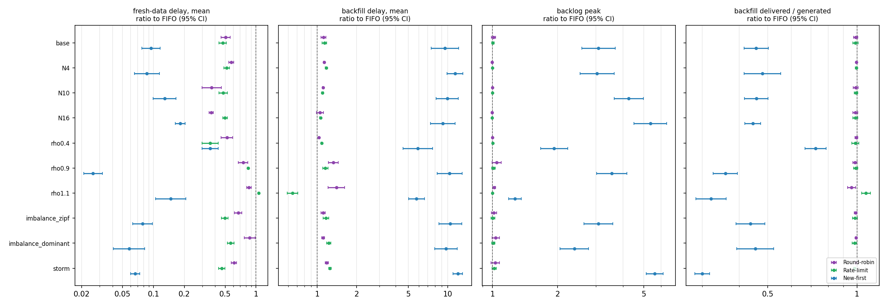
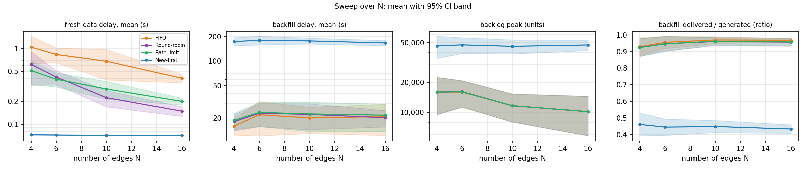
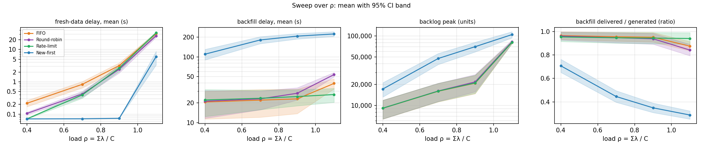

# Báo cáo: So sánh bốn chính sách điều phối gửi bù dữ liệu trên iFogSim2

**Đề tài 2, đồ án Mạng máy tính HK261.** Bộ khung mô phỏng: iFogSim2 mở rộng (`sim/`) và bản
mô phỏng trực quan trên trình duyệt (`web/`). Báo cáo này phân tích **800 lần chạy**
(10 kịch bản × 4 chính sách × 20 lần lặp) bằng phương pháp thống kê mô tả trong
[`STATISTICS.md`](STATISTICS.md). Mọi bảng số đầy đủ, kể cả các so sánh không đưa vào đây, nằm
trong [`analysis/STATS.md`](../analysis/STATS.md); dữ liệu gốc nằm trong `results/`.

---

## 1. Bài toán

Khi một máy chủ biên mất kết nối tới trung tâm, dữ liệu sinh ra trong lúc gián đoạn phải lưu lại
tại biên (tồn đọng). Khi kết nối được khôi phục, dữ liệu tồn đọng phải **gửi bù** trong khi dữ
liệu mới vẫn tiếp tục phát sinh, và cả hai cùng tranh một nút cổ chai là năng lực tiếp nhận `C` của
trung tâm. Chính sách điều phối quyết định mỗi vòng gửi bao nhiêu và gửi của ai, tức là đánh đổi
giữa độ trễ của dữ liệu mới và tốc độ xả tồn đọng.

## 2. Mô hình mô phỏng (tóm tắt [`MODEL.md`](MODEL.md))

* **Topology**: N máy chủ biên nối tới một trung tâm duy nhất. 1 đơn vị dữ liệu = 1 tuple của
  iFogSim2. Trung tâm nhận tối đa `C = 1200` đơn vị/s, cấp phát dưới dạng `⌊C·ΔT⌋ = 120` token
  mỗi chu kỳ quyết định `ΔT = 0.1 s`.
* **Tải**: biên i sinh dữ liệu theo quá trình Poisson với tốc độ `λ_i`, tổng `Σλ_i = ρ·C`.
  Phân bổ giữa các biên: đều (EVEN), Zipf, hoặc một biên chiếm 60% (DOMINANT).
* **Hai hàng đợi mỗi biên**: dữ liệu sinh khi đang kết nối là *dữ liệu mới*, dữ liệu sinh khi
  mất kết nối là *dữ liệu bù*.
* **Mô-đun gián đoạn** (Bước 2 của đề bài):
  * **SCATTERED**: mỗi biên có đồng hồ riêng. Thời gian giữa hai lần rơi theo phân bố mũ, thời
    gian gián đoạn theo log-normal (cv 0.8). Mỗi biên có cặp tham số riêng quanh trung bình chung
    0.01 lần rơi/s và 20 s gián đoạn: biên 0 rơi thường xuyên nhất (×1.5) nhưng hồi nhanh nhất
    (×0.85), biên N−1 rơi ít nhất (×0.5) nhưng hồi chậm nhất (×1.15). Các biên tái kết nối rải rác
    theo thời gian.
  * **COHORT** (kịch bản `storm`): cứ 120 s, 50% số biên đang kết nối rơi **cùng lúc** và hồi sau
    log-normal(20 s, cv 0.15), tức nhiều biên tái kết nối trong một khoảng ngắn.
* **Cơ chế công bằng**: mọi lần gửi đều đi qua bộ lập lịch; chính sách chỉ trả về quyết định cấp
  phát, bộ khung thực thi đúng quyết định đó. Cùng seed thì bốn chính sách nhận cùng luồng dữ liệu
  và cùng dòng thời gian gián đoạn (SelfTest kiểm chứng ở mỗi lần build).

## 3. Bốn chính sách

| chính sách | quy tắc |
|---|---|
| **FIFO** | gửi theo đúng thứ tự phát sinh trên toàn hệ thống: dữ liệu cũ nhất đi trước, nên sau khi tái kết nối thì dữ liệu mới xếp sau tồn đọng |
| **Round-robin (RR)** | chia đều ngân sách mỗi chu kỳ theo vòng cho các biên đang có dữ liệu; phần một biên không dùng hết được chuyển cho biên khác |
| **Rate-limit** | dữ liệu bù được gửi với tốc độ cố định `R = 0.5·C` bất kể tồn đọng lớn hay nhỏ; phần còn lại dành cho dữ liệu mới |
| **New-first** | dữ liệu mới được ưu tiên tuyệt đối; dữ liệu bù chỉ có hạn mức nhỏ cố định `q = 0.05·C` |

## 4. Thiết kế thí nghiệm

**Ba trục khảo sát của đề bài**, quét từng yếu tố quanh kịch bản gốc `base`
(N = 6, ρ = 0.7, EVEN, SCATTERED):

| trục | kịch bản |
|---|---|
| số lượng biên | `N4`, `base` (N = 6), `N10`, `N16` |
| tải dữ liệu mới so với năng lực trung tâm | `rho0.4`, `base` (ρ = 0.7), `rho0.9`, `rho1.1` (quá tải) |
| chênh lệch tồn đọng giữa các biên | `base` (EVEN), `imbalance_zipf`, `imbalance_dominant` |
| tái kết nối đồng loạt hay rải rác | `base` (SCATTERED), `storm` (COHORT) |

**Lặp và ghép cặp.** Mỗi ô (kịch bản × chính sách) chạy **20 lần lặp độc lập** (seed 0–19), mỗi
lần 600 s đo sau 50 s khởi động. Cùng một seed, bốn chính sách thấy cùng dữ liệu đầu vào, nên mọi
so sánh đều **ghép cặp theo seed** (số ngẫu nhiên chung). Mỗi lần chạy đóng góp một giá trị cho mỗi
chỉ số; không dùng độ trễ từng gói làm mẫu vì chúng phụ thuộc lẫn nhau trong cùng một lần chạy.

**Chỉ số** (chiều tốt hơn trong ngoặc): độ trễ dữ liệu mới trung bình và p95 (thấp), độ trễ dữ liệu
bù trung bình và p95 (thấp), đỉnh tồn đọng (thấp), thời gian xả tồn đọng sau tái kết nối (thấp), tỷ
lệ dữ liệu bù được giao trước khi hết giờ (cao), chỉ số công bằng Jain của việc giao dữ liệu bù (cao).

**Suy luận.** Khoảng tin cậy 95% theo phân phối t, đối chiếu với bootstrap BCa. Kiểm định
Friedman cho cả 4 chính sách. So sánh từng cặp trên log-tỷ số theo seed `log(A/B)`: paired
t-test, kiểm tra lại bằng Wilcoxon signed-rank, hiệu chỉnh Holm trong mỗi họ 6 so sánh. Khác biệt
giữa hai chính sách được báo cáo dưới dạng **tỷ số** `A/B` (trung bình nhân của các tỷ số theo
seed) kèm khoảng tin cậy 95%, ví dụ "+12% [+9%; +15%]". Một chính sách chỉ được coi là **hơn hẳn**
chính sách khác khi cả hai kiểm định đều có ý nghĩa sau hiệu chỉnh. Chi tiết và lý do chọn từng
phương pháp: [`STATISTICS.md`](STATISTICS.md).

## 5. Kết quả

### 5.1 Cách đọc kết quả

* Ô của bảng trung bình: **trung bình trên 20 lần lặp [khoảng tin cậy 95%]**. **Đậm** là trung bình
  tốt nhất. ✓ nghĩa là chính sách đó hơn hẳn cả ba chính sách còn lại. *Nghiêng* nghĩa là không
  phân biệt được với chính sách tốt nhất. ↓/↑: thấp/cao hơn là tốt hơn.
* Khoảng tin cậy của từng ô rộng vì mức tuyệt đối của một chỉ số phụ thuộc mạnh vào số lần và độ
  dài các đợt mất kết nối trong lần lặp đó. Ví dụ, độ trễ dữ liệu bù trung bình của FIFO ở `base`
  dao động từ 10.5 s đến 108 s giữa các seed. Vì vậy hai khoảng tin cậy chồng lên nhau **không**
  có nghĩa là hai chính sách như nhau. So sánh được làm ghép cặp trên cùng seed, và các bảng tỷ số
  ở §5.4 mới là căn cứ để kết luận.
* Tỷ số `A/B` là trung bình nhân của các tỷ số theo seed. "−49% [−54%; −44%]" nghĩa là trong một lần
  lặp điển hình, A thấp hơn B 49%, khoảng tin cậy 95% từ 44% đến 54%. Tỷ số này có thể khác tỷ số
  giữa hai trung bình cộng, vì trung bình cộng bị kéo bởi vài lần lặp có đợt mất kết nối dài.
* Ký hiệu trong các bảng tỷ số:
  * (ns): không có ý nghĩa thống kê.
  * ⁽ʷ⁾: chỉ Wilcoxon có ý nghĩa.
  * ⁽ᵗ⁾: chỉ t-test có ý nghĩa.

  Hai trường hợp ⁽ʷ⁾ và ⁽ᵗ⁾ không được tính là khác biệt vững. Ô không có ký hiệu là cả hai kiểm
  định đều có ý nghĩa sau hiệu chỉnh Holm.
* Số liệu đầy đủ của cả 10 kịch bản và 8 chỉ số nằm trong
  [`analysis/STATS.md`](../analysis/STATS.md) và các file `analysis/stats/*.csv`.

### 5.2 Tổng quan: chính sách tốt nhất theo kịch bản

Viết tắt: NF = New-first, RR = Round-robin, RL = Rate-limit. "A = B" nghĩa là B không phân biệt được
với A (tốt nhất).

| kịch bản | Độ trễ dữ liệu mới, TB | Độ trễ dữ liệu mới, p95 | Độ trễ dữ liệu bù, TB | Độ trễ dữ liệu bù, p95 | Đỉnh tồn đọng | Thời gian xả tồn đọng, TB | Tỷ lệ dữ liệu bù đã giao | Công bằng Jain (dữ liệu bù) |
|---|---|---|---|---|---|---|---|---|
| `base` | NF ✓ | NF ✓ | FIFO ✓ | FIFO ✓ | FIFO = RL = RR | RR ✓ | FIFO = RR = RL | RR = FIFO = RL |
| `N4` | NF ✓ | NF ✓ | FIFO ✓ | FIFO ✓ | RR = FIFO = RL | RR ✓ | FIFO = RR = RL | FIFO = RR = RL |
| `N10` | NF ✓ | NF = RR | FIFO ✓ | FIFO ✓ | FIFO = RR = RL | RR ✓ | FIFO = RL = RR | FIFO = RL = RR |
| `N16` | NF ✓ | NF ✓ | RR = FIFO = RL | FIFO ✓ | RR = RL = FIFO | RR ✓ | FIFO = RL = RR | FIFO = RL = RR |
| `rho0.4` | NF = RL | NF = RL | FIFO ✓ | FIFO ✓ | FIFO = RR = RL | RR ✓ | FIFO = RR = RL | RR = FIFO = RL |
| `rho0.9` | NF ✓ | NF ✓ | FIFO ✓ | FIFO ✓ | FIFO = RL = RR | RR ✓ | FIFO = RL = RR | FIFO = RR = RL |
| `rho1.1` | NF ✓ | NF ✓ | RL ✓ | RL ✓ | FIFO = RL | FIFO = RL = RR = NF | RL ✓ | RL = FIFO |
| `imbalance_zipf` | NF ✓ | NF ✓ | FIFO ✓ | FIFO ✓ | FIFO = RL = RR | RR ✓ | FIFO = RR = RL | RR = FIFO = RL |
| `imbalance_dominant` | NF ✓ | NF ✓ | FIFO ✓ | FIFO ✓ | FIFO = RL = RR | RR ✓ | FIFO = RR = RL | RR = FIFO = RL |
| `storm` | NF ✓ | NF ✓ | FIFO ✓ | FIFO ✓ | FIFO = RL = RR | RR ✓ | FIFO ✓ | FIFO = RR |

Ba quy luật lặp lại ở gần như mọi kịch bản:

1. **New-first** cho độ trễ dữ liệu mới thấp nhất ở cả 10 kịch bản. Ở `rho0.4`, Rate-limit cũng
   đạt mức đó vì khi tải thấp, ngân sách dành cho dữ liệu mới của nó đã đủ.
2. **FIFO** cho độ trễ dữ liệu bù thấp nhất và hơn hẳn ba chính sách kia ở 8/10 kịch bản. Hai ngoại
   lệ là `N16` (FIFO, RR, RL không phân biệt được) và `rho1.1` (Rate-limit thắng).
3. **Round-robin** xả tồn đọng nhanh nhất sau mỗi lần tái kết nối, hơn hẳn ở 9/10 kịch bản.

Ở các chỉ số đỉnh tồn đọng, tỷ lệ dữ liệu bù đã giao và công bằng, FIFO, RR và RL hầu như không phân
biệt được với nhau, còn New-first kém hơn rõ rệt.

### 5.3 Kịch bản gốc `base` (N = 6, ρ = 0.7, tải đều, mất kết nối rải rác)

| chỉ số | FIFO | Round-robin | Rate-limit | New-first | Friedman p (W) |
|---|---|---|---|---|---|
| Độ trễ dữ liệu mới, TB (s, ↓) | 0.837 [0.652; 1.02] | 0.421 [0.332; 0.511] | 0.394 [0.311; 0.478] | **0.072 [0.071; 0.073]** ✓ | <10⁻⁴ (0.93) |
| Độ trễ dữ liệu mới, p95 (s, ↓) | 4.46 [3.43; 5.50] | 1.37 [0.839; 1.90] | 1.86 [1.44; 2.28] | **0.107 [0.107; 0.107]** ✓ | <10⁻⁴ (0.93) |
| Độ trễ dữ liệu bù, TB (s, ↓) | **22.0 [12.1; 31.9]** ✓ | 23.0 [15.7; 30.3] | 23.5 [15.8; 31.3] | 181 [159; 203] | <10⁻⁴ (0.87) |
| Độ trễ dữ liệu bù, p95 (s, ↓) | **63.8 [29.5; 98.1]** ✓ | 67.3 [32.3; 102] | 66.9 [32.0; 102] | 343 [300; 387] | <10⁻⁴ (0.90) |
| Đỉnh tồn đọng (đơn vị, ↓) | **16 006 [11 230; 20 781]** | *16 150 [11 410; 20 889]* | *16 075 [11 312; 20 838]* | 47 473 [38 908; 56 038] | <10⁻⁴ (0.81) |
| Thời gian xả tồn đọng, TB (s, ↓) | 7.34 [6.71; 7.98] | **6.65 [6.16; 7.13]** ✓ | 7.62 [6.96; 8.27] | 117 [74.9; 159] | <10⁻⁴ (0.92) |
| Tỷ lệ dữ liệu bù đã giao (tỷ lệ, ↑) | **0.955 [0.918; 0.992]** | *0.947 [0.904; 0.990]* | *0.946 [0.900; 0.992]* | 0.446 [0.396; 0.495] | <10⁻⁴ (0.90) |
| Công bằng Jain (dữ liệu bù) (chỉ số, ↑) | *0.986 [0.971; 1.000]* | **0.986 [0.973; 0.999]** | *0.983 [0.967; 1.000]* | 0.756 [0.695; 0.818] | <10⁻⁴ (0.90) |

* **Đánh đổi chính nằm ở New-first.** Độ trễ dữ liệu mới của nó chỉ 0.072 s, thấp hơn FIFO 91%
  [88%; 92%]. p95 là 0.107 s, xấp xỉ một chu kỳ quyết định ΔT = 0.1 s, tức gần như dữ liệu mới
  không phải xếp hàng. Cái giá phải trả:
  * độ trễ dữ liệu bù 181 s so với 22 s; theo tỷ số trên từng seed thì gấp 9.5 lần;
  * đỉnh tồn đọng gấp khoảng 3 lần;
  * chỉ 45% dữ liệu bù được giao trong cửa sổ đo, so với 95% của FIFO.

  Nguyên nhân là hạn mức cố định `q = 0.05·C` dành cho dữ liệu bù quá nhỏ so với lượng tồn đọng
  tích lại sau mỗi đợt mất kết nối.
* **FIFO, RR và RL** giao gần như cùng một lượng dữ liệu bù (0.95, ns) với cùng đỉnh tồn đọng
  (khoảng 16 000 đơn vị, ns). Chúng khác nhau ở cách chia thời gian chờ:
  * RR và RL giảm độ trễ dữ liệu mới khoảng một nửa so với FIFO (−49% và −53%), đổi lại độ trễ
    dữ liệu bù tăng 12–13%;
  * RR xả tồn đọng nhanh nhất (6.65 s, −9% so với FIFO).
* Kiểm định Friedman bác bỏ giả thuyết "bốn chính sách như nhau" ở mọi chỉ số (p < 10⁻⁴). Hệ số
  Kendall W từ 0.81 đến 0.93 cho thấy thứ hạng các chính sách gần như giống nhau ở mọi seed.

### 5.4 So sánh với FIFO trên mọi kịch bản

FIFO là chính sách "tự nhiên" nhất: không ưu tiên gì, dữ liệu cũ đi trước. Các bảng dưới đây cho
biết mỗi chính sách khác thay đổi từng chỉ số bao nhiêu phần trăm so với FIFO, trên cùng seed.



**Độ trễ dữ liệu mới, trung bình**

| kịch bản | RR / FIFO | RL / FIFO | NF / FIFO |
|---|---|---|---|
| `base` | -49% [-54%; -44%] | -53% [-56%; -49%] | -91% [-92%; -88%] |
| `N4` | -42% [-46%; -39%] | -48% [-52%; -45%] | -91% [-93%; -89%] |
| `N10` | -63% [-70%; -54%] | -52% [-57%; -48%] | -87% [-90%; -83%] |
| `N16` | -64% [-65%; -62%] | -50% [-53%; -47%] | -82% [-84%; -80%] |
| `rho0.4` | -48% [-55%; -41%] | -64% [-70%; -57%] | -64% [-70%; -57%] |
| `rho0.9` | -25% [-33%; -17%] | -16% [-18%; -15%] | -97% [-98%; -97%] |
| `rho1.1` | -15% [-19%; -10%] | +6.1% [+4.7%; +7.5%] | -85% [-89%; -79%] |
| `imbalance_zipf` | -33% [-38%; -27%] | -50% [-54%; -47%] | -92% [-94%; -90%] |
| `imbalance_dominant` | -13% [-23%; -2.1%] | -43% [-48%; -39%] | -94% [-96%; -92%] |
| `storm` | -39% [-42%; -35%] | -54% [-57%; -50%] | -93% [-94%; -93%] |

**Độ trễ dữ liệu mới, p95** (đuôi phân phối, quan trọng với ứng dụng thời gian thực)

| kịch bản | RR / FIFO | RL / FIFO | NF / FIFO |
|---|---|---|---|
| `base` | -78% [-85%; -67%] | -58% [-62%; -54%] | -97% [-98%; -97%] |
| `N4` | -55% [-70%; -31%] | -51% [-54%; -48%] | -98% [-98%; -97%] |
| `N10` | -96% [-97%; -94%] | -61% [-66%; -56%] | -96% [-97%; -95%] |
| `N16` | -94% [-95%; -93%] | -63% [-66%; -59%] | -94% [-95%; -93%] |
| `rho0.4` | -85% [-89%; -80%] | -85% [-89%; -81%] | -85% [-89%; -81%] |
| `rho0.9` | +49% [+32%; +69%] | -18% [-20%; -15%] | -99% [-99%; -99%] |
| `rho1.1` | +58% [+41%; +76%] | +12% [+8.4%; +15%] | -79% [-85%; -72%] |
| `imbalance_zipf` | -33% [-48%; -15%] | -56% [-61%; -50%] | -98% [-98%; -97%] |
| `imbalance_dominant` | +3.8% [-11%; +21%] (ns) | -47% [-50%; -43%] | -98% [-99%; -98%] |
| `storm` | -21% [-28%; -14%] | -56% [-59%; -52%] | -98% [-98%; -98%] |

**Độ trễ dữ liệu bù, trung bình**

| kịch bản | RR / FIFO | RL / FIFO | NF / FIFO |
|---|---|---|---|
| `base` | +12% [+6.9%; +16%] | +13% [+8.9%; +18%] | +850% [+646%; +1110%] |
| `N4` | +13% [+12%; +15%] | +17% [+15%; +19%] | +1038% [+890%; +1208%] |
| `N10` | +11% [+9.7%; +12%] | +9.9% [+8.3%; +12%] | +891% [+713%; +1108%] |
| `N16` | +4.8% [-1.6%; +11%] ⁽ʷ⁾ | +5.9% [+4.4%; +7.5%] | +816% [+638%; +1036%] |
| `rho0.4` | +2.8% [+2.4%; +3.1%] | +8.0% [+7.2%; +8.8%] | +489% [+354%; +665%] |
| `rho0.9` | +33% [+22%; +45%] | +15% [+10.0%; +21%] | +934% [+730%; +1188%] |
| `rho1.1` | +40% [+21%; +62%] | -35% [-41%; -29%] | +477% [+403%; +562%] |
| `imbalance_zipf` | +11% [+7.2%; +15%] | +16% [+11%; +22%] | +948% [+754%; +1185%] |
| `imbalance_dominant` | +11% [+8.5%; +14%] | +23% [+18%; +27%] | +869% [+693%; +1085%] |
| `storm` | +18% [+15%; +22%] | +25% [+23%; +28%] | +1096% [+1000%; +1201%] |

**Thời gian xả tồn đọng sau tái kết nối**

| kịch bản | RR / FIFO | RL / FIFO | NF / FIFO |
|---|---|---|---|
| `base` | -9.0% [-12%; -5.9%] | +3.8% [+1.3%; +6.3%] | +1158% [+781%; +1696%] |
| `N4` | -3.7% [-6.7%; -0.5%] | +1.8% [+0.7%; +2.9%] | +866% [+482%; +1503%] |
| `N10` | -11% [-15%; -8.0%] | +2.6% [+0.2%; +5.0%] | +2426% [+1891%; +3104%] |
| `N16` | -15% [-19%; -11%] | +0.6% [-0.8%; +2.0%] (ns) | +2759% [+2184%; +3478%] |
| `rho0.4` | -3.4% [-5.6%; -1.2%] | +37% [+30%; +46%] | +3155% [+2567%; +3873%] |
| `rho0.9` | -16% [-22%; -8.9%] | +0.5% [-1.0%; +2.0%] (ns) | +275% [+160%; +442%] |
| `rho1.1` | +86% [-15%; +310%] (ns) | +6.6% [-5.6%; +20%] (ns) | +323% [+60%; +1016%] ⁽ʷ⁾ |
| `imbalance_zipf` | -17% [-24%; -9.1%] | +4.0% [+1.9%; +6.0%] | +1100% [+767%; +1561%] |
| `imbalance_dominant` | -28% [-35%; -21%] | +4.0% [-0.3%; +8.5%] ⁽ʷ⁾ | +927% [+663%; +1282%] |
| `storm` | -15% [-19%; -11%] | +8.7% [+5.2%; +12%] | +1323% [+1059%; +1646%] |

**Đỉnh tồn đọng**

| kịch bản | RR / FIFO | RL / FIFO | NF / FIFO |
|---|---|---|---|
| `base` | +1.2% [-1.0%; +3.4%] (ns) | +0.6% [-0.7%; +1.9%] (ns) | +208% [+158%; +268%] |
| `N4` | -0.4% [-1.2%; +0.4%] (ns) | +0.0% [-0.3%; +0.3%] (ns) | +204% [+153%; +265%] |
| `N10` | -0.0% [-0.4%; +0.3%] (ns) | +0.0% [-0.3%; +0.4%] (ns) | +325% [+264%; +397%] |
| `N16` | -0.5% [-1.2%; +0.2%] (ns) | -0.2% [-0.9%; +0.4%] (ns) | +435% [+350%; +536%] |
| `rho0.4` | +0.1% [-0.2%; +0.5%] (ns) | +0.3% [-0.3%; +0.9%] (ns) | +93% [+67%; +123%] |
| `rho0.9` | +4.8% [-0.2%; +10%] (ns) | +1.0% [-0.8%; +2.9%] (ns) | +256% [+202%; +318%] |
| `rho1.1` | +1.9% [+0.4%; +3.4%] | +0.1% [-0.1%; +0.4%] (ns) | +27% [+19%; +36%] |
| `imbalance_zipf` | +1.6% [-1.2%; +4.5%] (ns) | +0.6% [-1.4%; +2.6%] (ns) | +208% [+165%; +259%] |
| `imbalance_dominant` | +3.6% [-0.3%; +7.8%] (ns) | +1.0% [-0.6%; +2.7%] (ns) | +139% [+105%; +177%] |
| `storm` | +3.1% [-1.5%; +7.8%] (ns) | +2.1% [-0.3%; +4.4%] (ns) | +460% [+412%; +514%] |

**Tỷ lệ dữ liệu bù đã giao**

| kịch bản | RR / FIFO | RL / FIFO | NF / FIFO |
|---|---|---|---|
| `base` | -1.0% [-2.5%; +0.5%] (ns) | -1.2% [-3.2%; +0.9%] (ns) | -54% [-58%; -50%] |
| `N4` | -0.4% [-1.0%; +0.1%] (ns) | -0.5% [-1.2%; +0.1%] (ns) | -52% [-58%; -45%] |
| `N10` | -1.0% [-2.8%; +0.9%] (ns) | -0.8% [-2.2%; +0.7%] (ns) | -54% [-58%; -50%] |
| `N16` | -1.3% [-3.3%; +0.7%] ⁽ʷ⁾ | -1.3% [-3.2%; +0.7%] ⁽ʷ⁾ | -55% [-58%; -53%] |
| `rho0.4` | -0.5% [-1.5%; +0.5%] (ns) | -1.3% [-3.9%; +1.3%] (ns) | -28% [-33%; -21%] |
| `rho0.9` | -1.5% [-3.1%; +0.0%] ⁽ʷ⁾ | -1.0% [-2.7%; +0.7%] (ns) | -64% [-67%; -60%] |
| `rho1.1` | -4.1% [-7.2%; -1.1%] | +7.3% [+3.7%; +11%] | -68% [-71%; -64%] |
| `imbalance_zipf` | -1.0% [-2.0%; +0.0%] (ns) | -1.6% [-3.4%; +0.3%] (ns) | -56% [-61%; -51%] |
| `imbalance_dominant` | -0.6% [-1.3%; +0.0%] (ns) | -1.8% [-3.6%; -0.1%] (ns) | -55% [-61%; -48%] |
| `storm` | -0.7% [-1.2%; -0.2%] | -1.9% [-2.6%; -1.1%] | -70% [-72%; -68%] |

Nhận xét:

* **New-first** giảm độ trễ dữ liệu mới 64–97% so với FIFO ở mọi kịch bản. Đổi lại:
  * độ trễ dữ liệu bù gấp 5.8 đến 12 lần;
  * thời gian xả tồn đọng gấp 3.8 đến 33 lần;
  * tỷ lệ dữ liệu bù đã giao thấp hơn 28–70%.

  Đây là đánh đổi lớn nhất và ổn định nhất của cả thí nghiệm.
* **Round-robin** có độ trễ dữ liệu mới trung bình tốt hơn FIFO ở mọi kịch bản. Tuy vậy, **đuôi
  p95 của nó tệ hơn FIFO khi tải cao**: +49% ở ρ = 0.9 và +58% ở ρ = 1.1. Ở `imbalance_dominant`
  thì p95 của RR không khác FIFO. RR chia đều ngân sách cho các biên đang có dữ liệu, nên khi tải
  cao hoặc dồn vào một biên, phần chia đều không còn khớp với nơi dữ liệu thực sự phát sinh. Bù
  lại, RR xả tồn đọng nhanh hơn FIFO 3–28% ở mọi kịch bản không quá tải.
* **Rate-limit** giảm độ trễ dữ liệu mới so với FIFO ở mọi kịch bản không quá tải, cả trung bình
  lẫn p95, kể cả ở ρ = 0.9 và khi tải lệch. Cái giá là độ trễ dữ liệu bù cao hơn FIFO 6–25%. Ở
  ρ = 1.1, Rate-limit đảo chiều: dữ liệu mới chậm hơn FIFO một chút (+6%), nhưng dữ liệu bù nhanh hơn
  35% (xem §5.6).
* **Đỉnh tồn đọng** của FIFO, RR và RL không phân biệt được ở 9/10 kịch bản. Đỉnh tồn đọng do
  độ dài các đợt mất kết nối quyết định, mà mọi chính sách đều chịu cùng dòng thời gian mất kết
  nối. Chính sách chỉ ảnh hưởng đến tốc độ xả sau đó, trừ khi xả quá chậm như New-first.

### 5.5 Trục số lượng biên N

Tổng tải giữ nguyên (ρ = 0.7). Mỗi ô là mức thay đổi của chỉ số khi đi từ mức N này sang mức kế
tiếp, ghép cặp theo seed.

| chỉ số | bước | FIFO | Round-robin | Rate-limit | New-first |
|---|---|---|---|---|---|
| Độ trễ dữ liệu mới, TB | 4 → 6 | -9.7% [-26%; +9.7%] (ns) | -20% [-37%; +0.5%] (ns) | -17% [-33%; +3.1%] (ns) | -0.8% [-2.7%; +1.0%] (ns) |
| Độ trễ dữ liệu mới, TB | 6 → 10 | -27% [-44%; -4.8%] | -47% [-56%; -36%] | -27% [-42%; -7.1%] | -1.2% [-2.6%; +0.1%] (ns) |
| Độ trễ dữ liệu mới, TB | 10 → 16 | -29% [-47%; -4.8%] | -30% [-45%; -11%] | -26% [-40%; -8.1%] | +0.8% [-0.7%; +2.2%] (ns) |
| Độ trễ dữ liệu bù, TB | 4 → 6 | +24% [-0.9%; +55%] (ns) | +22% [+0.9%; +47%] | +20% [-0.9%; +45%] (ns) | +3.4% [-3.3%; +11%] (ns) |
| Độ trễ dữ liệu bù, TB | 6 → 10 | -3.5% [-17%; +12%] (ns) | -4.2% [-17%; +10%] (ns) | -6.5% [-19%; +7.2%] (ns) | +0.7% [-11%; +14%] (ns) |
| Độ trễ dữ liệu bù, TB | 10 → 16 | +2.4% [-14%; +22%] (ns) | -3.1% [-19%; +16%] (ns) | -1.3% [-18%; +18%] (ns) | -5.4% [-13%; +2.5%] (ns) |
| Đỉnh tồn đọng | 4 → 6 | +7.8% [-11%; +30%] (ns) | +9.6% [-9.4%; +33%] (ns) | +8.4% [-10%; +31%] (ns) | +9.3% [-8.0%; +30%] (ns) |
| Đỉnh tồn đọng | 6 → 10 | -28% [-40%; -13%] | -28% [-41%; -14%] | -28% [-40%; -13%] | -0.1% [-15%; +18%] (ns) |
| Đỉnh tồn đọng | 10 → 16 | -16% [-34%; +6.0%] (ns) | -17% [-34%; +5.6%] (ns) | -16% [-34%; +5.8%] (ns) | +5.5% [-7.0%; +20%] (ns) |
| Tỷ lệ dữ liệu bù đã giao | 4 → 6 | +3.4% [-2.9%; +10%] (ns) | +2.8% [-2.6%; +8.6%] (ns) | +2.8% [-2.5%; +8.3%] (ns) | -1.3% [-10%; +8.5%] (ns) |
| Tỷ lệ dữ liệu bù đã giao | 6 → 10 | +1.8% [-2.5%; +6.2%] (ns) | +1.8% [-2.3%; +6.0%] (ns) | +2.2% [-2.4%; +7.0%] (ns) | +1.8% [-6.0%; +10%] (ns) |
| Tỷ lệ dữ liệu bù đã giao | 10 → 16 | -0.0% [-2.7%; +2.7%] (ns) | -0.4% [-3.1%; +2.4%] (ns) | -0.5% [-3.4%; +2.4%] (ns) | -2.7% [-9.2%; +4.3%] (ns) |



* Nhiều biên hơn thì mỗi biên mang phần tải nhỏ hơn (`λ_i = ρ·C/N`). Một đợt mất kết nối vì thế
  giữ lại ít dữ liệu hơn:
  * đỉnh tồn đọng giảm 28% khi N tăng từ 6 lên 10;
  * độ trễ dữ liệu mới của FIFO, RR và RL giảm 26–47% ở mỗi bước từ 6 lên 10 và từ 10 lên 16.
* Độ trễ dữ liệu bù và tỷ lệ giao hầu như **không đổi có ý nghĩa** theo N. Ngoại lệ duy nhất là
  độ trễ bù của RR tăng 22% khi N đi từ 4 lên 6. Các chỉ số của New-first không phụ thuộc N.
* Thứ hạng giữa các chính sách giữ nguyên ở mọi N (§5.2). Riêng ở N = 16, khác biệt về độ trễ dữ liệu
  bù giữa FIFO, RR và RL nhỏ đến mức không phân biệt được.

### 5.6 Trục tải ρ, kể cả quá tải

| chỉ số | bước | FIFO | Round-robin | Rate-limit | New-first |
|---|---|---|---|---|---|
| Độ trễ dữ liệu mới, TB | 0.4 → 0.7 | +280% [+230%; +337%] | +271% [+219%; +332%] | +404% [+314%; +514%] | +0.8% [+0.2%; +1.3%] |
| Độ trễ dữ liệu mới, TB | 0.7 → 0.9 | +279% [+262%; +297%] | +460% [+412%; +512%] | +570% [+507%; +640%] | +3.2% [+2.5%; +4.0%] |
| Độ trễ dữ liệu mới, TB | 0.9 → 1.1 | +953% [+754%; +1199%] | +1100% [+836%; +1438%] | +1234% [+980%; +1547%] | +5922% [+4130%; +8472%] |
| Độ trễ dữ liệu bù, TB | 0.4 → 0.7 | +6.8% [+6.1%; +7.5%] | +16% [+11%; +21%] | +12% [+8.0%; +17%] | +72% [+56%; +90%] |
| Độ trễ dữ liệu bù, TB | 0.7 → 0.9 | +6.8% [+4.9%; +8.6%] | +27% [+19%; +36%] | +8.6% [+6.1%; +11%] | +16% [+11%; +21%] |
| Độ trễ dữ liệu bù, TB | 0.9 → 1.1 | +95% [+73%; +120%] | +105% [+73%; +143%] | +9.1% [+6.7%; +12%] | +8.6% [+6.2%; +11%] |
| Đỉnh tồn đọng | 0.4 → 0.7 | +76% [+75%; +78%] | +78% [+74%; +82%] | +77% [+74%; +79%] | +182% [+161%; +205%] |
| Đỉnh tồn đọng | 0.7 → 0.9 | +31% [+30%; +32%] | +36% [+29%; +42%] | +32% [+30%; +33%] | +51% [+46%; +56%] |
| Đỉnh tồn đọng | 0.9 → 1.1 | +336% [+261%; +426%] | +324% [+254%; +408%] | +332% [+259%; +420%] | +56% [+39%; +75%] |
| Tỷ lệ dữ liệu bù đã giao | 0.4 → 0.7 | -1.1% [-3.2%; +1.0%] (ns) | -1.6% [-4.2%; +1.0%] (ns) | -0.9% [-2.5%; +0.6%] (ns) | -38% [-40%; -35%] |
| Tỷ lệ dữ liệu bù đã giao | 0.7 → 0.9 | -0.5% [-1.4%; +0.4%] (ns) | -1.1% [-2.0%; -0.1%] | -0.4% [-0.9%; +0.2%] (ns) | -22% [-22%; -21%] |
| Tỷ lệ dữ liệu bù đã giao | 0.9 → 1.1 | -8.1% [-11%; -5.3%] | -10% [-14%; -7.3%] | -0.4% [-0.8%; +0.1%] (ns) | -18% [-18%; -17%] |



* **Độ trễ dữ liệu mới** của FIFO, RR và RL tăng rất nhanh theo tải: khoảng 4–7 lần ở mỗi bước từ
  0.4 lên 0.7 rồi lên 0.9, và khoảng 10–13 lần khi sang ρ = 1.1. New-first gần như không đổi đến
  ρ = 0.9 (+0.8%, +3.2%), vì dữ liệu mới luôn được đi trước. Chỉ khi quá tải thì dữ liệu mới của nó
  mới phải xếp hàng (6.04 s).
* **Tỷ lệ dữ liệu bù đã giao** của New-first giảm mạnh theo tải: 71% ở ρ = 0.4, 45% ở 0.7, 35% ở
  0.9 và 29% ở 1.1. Phần năng lực còn dư sau khi phục vụ dữ liệu mới ngày càng ít.
* **Quá tải (`rho1.1`)**: tồn đọng tăng liên tục nên mọi chỉ số đều tệ đi nhiều lần. Đây cũng là
  kịch bản duy nhất mà thứ hạng thay đổi:

| chỉ số | FIFO | Round-robin | Rate-limit | New-first | Friedman p (W) |
|---|---|---|---|---|---|
| Độ trễ dữ liệu mới, TB (s, ↓) | 30.9 [28.3; 33.5] | 26.5 [23.9; 29.1] | 32.8 [30.1; 35.6] | **6.04 [3.32; 8.76]** ✓ | <10⁻⁴ (0.94) |
| Độ trễ dữ liệu mới, p95 (s, ↓) | 56.3 [51.7; 60.9] | 88.6 [80.2; 97.0] | 62.7 [57.6; 67.9] | **14.2 [9.20; 19.2]** ✓ | <10⁻⁴ (0.96) |
| Độ trễ dữ liệu bù, TB (s, ↓) | 39.5 [32.7; 46.4] | 53.8 [49.7; 57.9] | **26.8 [20.4; 33.2]** ✓ | 223 [204; 241] | <10⁻⁴ (0.94) |
| Độ trễ dữ liệu bù, p95 (s, ↓) | 81.3 [48.7; 114] | 118 [103; 133] | **72.3 [37.0; 108]** ✓ | 417 [381; 454] | <10⁻⁴ (0.86) |
| Đỉnh tồn đọng (đơn vị, ↓) | **81 177 [77 642; 84 712]** | 82 862 [78 301; 87 422] | *81 289 [77 692; 84 886]* | 104 956 [94 355; 115 556] | <10⁻⁴ (0.71) |
| Thời gian xả tồn đọng, TB (s, ↓) | **38.4 [17.6; 59.3]** | *66.9 [48.1; 85.7]* | *39.0 [18.7; 59.3]* | *125 [78.4; 172]* | 0.0006 (0.65) |
| Tỷ lệ dữ liệu bù đã giao (tỷ lệ, ↑) | 0.875 [0.835; 0.914] | 0.841 [0.793; 0.890] | **0.940 [0.891; 0.990]** ✓ | 0.288 [0.253; 0.323] | <10⁻⁴ (0.92) |
| Công bằng Jain (dữ liệu bù) (chỉ số, ↑) | *0.972 [0.957; 0.988]* | 0.966 [0.949; 0.983] | **0.982 [0.963; 1.000]** | 0.676 [0.605; 0.747] | <10⁻⁴ (0.83) |

* Ở `rho1.1`, Rate-limit hơn hẳn các chính sách còn lại về dữ liệu bù:
  * độ trễ bù 26.8 s, so với 39.5 s của FIFO (−35% [−41%; −29%]) và 53.8 s của RR;
  * tỷ lệ giao 94%, so với 87.5% của FIFO.

  Nó dành cố định `R = 0.5·C` cho dữ liệu bù, nên dữ liệu bù không bị dữ liệu mới (lúc này lớn hơn
  năng lực trung tâm) chèn ép. Độ trễ dữ liệu bù của Rate-limit tăng có 9% khi ρ đi từ 0.9 lên 1.1,
  trong khi của FIFO và RR tăng gấp đôi (+95%, +105%). Dữ liệu mới thì New-first vẫn tốt nhất (6.0 s
  so với 26–33 s của các chính sách khác).

### 5.7 Chênh lệch tồn đọng giữa các biên

`imbalance_zipf` phân bổ tải theo Zipf, `imbalance_dominant` cho một biên mang 60% tổng tải. Số liệu
đầy đủ ở `STATS.md` §1.

* Thứ hạng tổng thể giữ nguyên: New-first nhanh nhất cho dữ liệu mới, FIFO nhanh nhất cho dữ liệu
  bù (✓ ở cả hai kịch bản), RR xả nhanh nhất.
* **Round-robin mất phần lớn ưu thế về dữ liệu mới khi tải dồn vào một biên.** So với FIFO, độ trễ
  dữ liệu mới trung bình của nó chỉ còn thấp hơn 13% [2%; 23%] ở `imbalance_dominant`, trong khi ở
  `base` là 49%, và p95 thì không khác FIFO. Rate-limit vẫn giữ được: −43% (trung bình) và −47%
  (p95). Đổi lại, RR xả tồn đọng nhanh nhất trong kịch bản này: −28% so với FIFO, mức cao nhất của
  mọi kịch bản.
* Độ trễ dữ liệu bù của RL cao hơn FIFO 16% (Zipf) và 23% (dominant), cao hơn mức 13% ở `base`.

### 5.8 Tái kết nối đồng loạt (`storm`) so với rải rác (`base`)

| chỉ số | FIFO | Round-robin | Rate-limit | New-first | Friedman p (W) |
|---|---|---|---|---|---|
| Độ trễ dữ liệu mới, TB (s, ↓) | 1.24 [1.10; 1.38] | 0.774 [0.659; 0.888] | 0.573 [0.517; 0.628] | **0.081 [0.079; 0.082]** ✓ | <10⁻⁴ (0.98) |
| Độ trễ dữ liệu mới, p95 (s, ↓) | 5.98 [5.30; 6.66] | 4.79 [4.18; 5.40] | 2.64 [2.40; 2.87] | **0.107 [0.106; 0.107]** ✓ | <10⁻⁴ (0.98) |
| Độ trễ dữ liệu bù, TB (s, ↓) | **14.5 [13.2; 15.7]** ✓ | 17.2 [15.5; 19.0] | 18.2 [16.4; 20.0] | 172 [162; 181] | <10⁻⁴ (0.96) |
| Độ trễ dữ liệu bù, p95 (s, ↓) | **35.0 [29.1; 40.8]** ✓ | 41.4 [33.6; 49.1] | 39.3 [32.8; 45.7] | 305 [288; 322] | <10⁻⁴ (0.87) |
| Đỉnh tồn đọng (đơn vị, ↓) | **13 531 [12 162; 14 900]** | *14 077 [12 406; 15 749]* | *13 851 [12 382; 15 320]* | 75 125 [69 154; 81 096] | <10⁻⁴ (0.66) |
| Thời gian xả tồn đọng, TB (s, ↓) | 10.2 [9.33; 11.0] | **8.59 [8.01; 9.18]** ✓ | 11.1 [10.1; 12.2] | 149 [114; 185] | <10⁻⁴ (0.91) |
| Tỷ lệ dữ liệu bù đã giao (tỷ lệ, ↑) | **0.969 [0.958; 0.979]** ✓ | 0.962 [0.952; 0.973] | 0.951 [0.938; 0.963] | 0.292 [0.277; 0.308] | <10⁻⁴ (0.91) |
| Công bằng Jain (dữ liệu bù) (chỉ số, ↑) | **0.996 [0.993; 0.998]** | *0.995 [0.992; 0.998]* | 0.994 [0.990; 0.997] | 0.695 [0.632; 0.758] | <10⁻⁴ (0.78) |

* Ở `storm`, cứ 120 s thì một nửa số biên đang kết nối rơi cùng lúc rồi tái kết nối gần như cùng
  lúc. Các đợt mất kết nối đều đặn hơn, nên khoảng tin cậy hẹp hơn `base` nhiều.
* Thứ hạng giữ nguyên, nhưng khác biệt giữa FIFO, RR và RL **rõ hơn**:
  * FIFO hơn hẳn về độ trễ dữ liệu bù (14.5 s; RR +18%, RL +25%) và về tỷ lệ giao (96.9%), chỉ số
    sau ở `base` thì không phân biệt được;
  * Rate-limit vẫn cho dữ liệu mới nhanh nhất trong ba chính sách không bỏ đói dữ liệu bù (−54% so
    với FIFO).
* **New-first chịu thiệt nhiều nhất khi tái kết nối đồng loạt.** Nó chỉ giao được 29% dữ liệu bù,
  so với 45% ở `base`. Đỉnh tồn đọng của nó gấp 5.6 lần FIFO (75 000 so với 13 500 đơn vị), so với
  khoảng 3 lần ở `base`. Hạn mức `q` cố định không tăng theo số biên cùng có tồn đọng.

### 5.9 Công bằng giữa các biên

Chỉ số Jain của việc giao dữ liệu bù cho FIFO, RR và RL đều từ 0.966 trở lên ở mọi kịch bản. Ba
chính sách này hầu như không phân biệt được: chênh lệch so với FIFO dưới 1%, phần lớn là ns.
New-first thấp hơn rõ rệt, từ 0.676 (`rho1.1`) đến 0.899 (`rho0.4`). Biên nào có tồn đọng lớn thì
bị hạn mức nhỏ giữ lại lâu hơn, nên dữ liệu bù được giao không đều giữa các biên.

### 5.10 Độ tin cậy của các kết luận

* **378/480** so sánh cặp có ý nghĩa theo t-test với hiệu chỉnh Holm trong từng họ, và **384/480**
  khi kiểm soát FDR toàn cục bằng Benjamini–Hochberg. Hai cách kiểm soát cho kết luận gần như trùng
  nhau.
* t-test và Wilcoxon cho kết luận khác nhau ở **17/480** so sánh. Theo quy tắc ở §4, các so sánh
  này không được tính là khác biệt vững. Phần lớn rơi vào các cặp FIFO/RR/RL có tỷ số gần 1, chẳng
  hạn ở `N16`.
* Shapiro–Wilk bác bỏ tính chuẩn của log-tỷ số ở 238/480 so sánh. Đó là lý do mọi kết luận "hơn
  hẳn" đều đòi hỏi thêm Wilcoxon, vốn không cần giả định chuẩn.
* **Số ngẫu nhiên chung** giảm phương sai của so sánh theo trung vị 2.6 lần (khoảng tứ phân vị
  1.2–24.7 lần), tức tương đương với việc chạy thêm từng ấy lần lặp nếu các chính sách được chạy
  độc lập.
* **Độ chính xác** (`STATS.md` §5): ở ô kém nhất của mỗi kịch bản và chỉ số, giá trị tuyệt đối có
  sai số tương đối từ ±5% đến ±57%, vì các lần lặp khác nhau nhiều. Tỷ số giữa hai chính sách thì chính xác hơn nhiều: nửa độ rộng
  trung vị từ ±3% đến ±28% tùy kịch bản và chỉ số. Những so sánh còn rộng đều là cặp có tỷ số gần
  1, tức hai chính sách gần như tương đương về chỉ số đó.

## 6. Chọn chính sách theo điều kiện

| Điều kiện hoặc mục tiêu | Nên chọn | Căn cứ (20 lần lặp, so với FIFO trên cùng seed) |
|---|---|---|
| Dữ liệu mới phải đến ngay (giám sát, cảnh báo), dữ liệu bù chờ được | **New-first** | độ trễ dữ liệu mới thấp nhất ở 10/10 kịch bản (−64% đến −97%); nhưng độ trễ bù gấp 5.8–12 lần, và chỉ 29–71% dữ liệu bù kịp giao |
| Dữ liệu bù phải về sớm và đủ (đối soát, tính cước, lưu trữ) | **FIFO** | độ trễ bù thấp nhất, hơn hẳn ở 8/10 kịch bản; tỷ lệ giao cao nhất hoặc ngang cao nhất ở 9/10 |
| Cân bằng hai loại dữ liệu khi tải vừa (ρ ≤ 0.7) và chia đều giữa các biên | **Round-robin** | ở `base`, `N4`, `N10`, `N16` và `rho0.4`: độ trễ dữ liệu mới −42% đến −64%, độ trễ bù chỉ +3% đến +13%; xả tồn đọng nhanh nhất ở 9/10 kịch bản |
| Tải cao (ρ ≈ 0.9) hoặc tải dồn vào một biên | **Rate-limit** | p95 dữ liệu mới −18% (ρ = 0.9) và −47% (`imbalance_dominant`); RR ở hai kịch bản này có p95 tệ hơn FIFO (+49%) hoặc không khác |
| Quá tải (ρ > 1) | **Rate-limit** cho dữ liệu bù, **New-first** cho dữ liệu mới | RL: độ trễ bù −35%, tỷ lệ giao 94% (✓); NF: dữ liệu mới 6.0 s so với 26–33 s |
| Nhiều biên tái kết nối cùng lúc | **FIFO**, hoặc **Rate-limit** nếu cần dữ liệu mới nhanh hơn | FIFO ✓ cả độ trễ bù lẫn tỷ lệ giao; RL −54% độ trễ dữ liệu mới, độ trễ bù +25%; tránh New-first (chỉ 29% dữ liệu bù kịp giao) |
| Công bằng giữa các biên | FIFO, RR hoặc RL | Jain ≥ 0.966, chênh nhau dưới 1%; New-first thấp nhất (0.68–0.90) |

Không có chính sách nào tốt nhất mọi mặt. Nếu phải chọn một chính sách mặc định khi chưa biết trước
điều kiện vận hành, **Rate-limit là lựa chọn ít rủi ro nhất** (nhận định của nhóm dựa trên các số
liệu trên):

* Nó không thua nặng ở chỉ số nào. Khi không quá tải, dữ liệu bù chậm hơn FIFO 6–25% và thời gian
  xả dài hơn tới 37%, nhưng đỉnh tồn đọng và tỷ lệ giao thì không phân biệt được.
* Khi tải ≤ 0.7, nó giảm độ trễ dữ liệu mới khoảng một nửa so với FIFO.
* Nó giữ đuôi p95 tốt khi tải cao hoặc lệch.
* Nó là chính sách tốt nhất cho dữ liệu bù khi quá tải.

Nhận định này gắn với tham số `R = 0.5·C` đã dùng.

## 7. Giới hạn

* **Thiết kế quét từng yếu tố** quanh `base`: kết luận chỉ áp dụng cho các mức đã thử, và không
  đo được tương tác giữa các yếu tố, ví dụ khi N lớn và tải cao xảy ra cùng lúc.
* **`rho1.1` không có trạng thái dừng.** Tải vượt năng lực nên tồn đọng tăng liên tục, và giá trị
  của mọi chỉ số phụ thuộc độ dài cửa sổ đo (600 s). So sánh giữa các chính sách vẫn hợp lệ vì cùng
  cửa sổ, nhưng không được ngoại suy giá trị tuyệt đối sang cửa sổ dài hơn.
* **Chỉ số chỉ tính trên phần đã hoàn tất.** `backDelayMean` chỉ tính dữ liệu bù đã giao, và
  `drainMean` chỉ tính các lần xả đã xong trong cửa sổ. New-first giao ít dữ liệu bù, nên hai chỉ
  số này của nó là ước lượng lạc quan và phải đọc cùng tỷ lệ dữ liệu bù đã giao.
* **Kịch bản `storm`** dùng hành vi đã publish: sau một storm, biên vẫn rơi lẻ theo đồng hồ riêng
  ([`MODEL.md`](MODEL.md) §5). PR #1 thêm cờ `cohortStormsOnly` để chạy kiểu chỉ rơi theo storm;
  với 5 seed, đổi cờ không làm thay đổi thứ hạng các chính sách.
* **Tham số chính sách cố định**: Rate-limit `R = 0.5·C`, New-first `q = 0.05·C`. Kết luận về hai
  chính sách này gắn với các giá trị đó. Ví dụ, New-first với `q` lớn hơn sẽ xả tồn đọng nhanh hơn
  nhưng đổi lại độ trễ dữ liệu mới cao hơn.
* **Mức chính xác**: 20 lần lặp mỗi ô. Một số so sánh giữa FIFO, RR và Rate-limit có tỷ số gần 1
  và khoảng tin cậy rộng. Kết luận đúng cho các so sánh đó là "không phân biệt được với 20 lần lặp",
  chứ không phải "bằng nhau". Độ chính xác từng so sánh nằm ở `STATS.md` §5.2.

## 8. Tái lập và demo

```powershell
pip install -r analysis/requirements.txt
python analysis/stats.py                       # tính lại mọi bảng, CSV và hình từ results/
.\sim\demo.ps1                                 # in kết luận từ dữ liệu đã commit (1–2 phút)
.\sim\demo.ps1 -Mode quick -Scenario storm     # chạy trực tiếp 4 chính sách × 10 seed rồi phân tích
.\sim\demo.ps1 -Mode web                       # mở mô phỏng trực quan trên trình duyệt
.\sim\run.ps1 grid -FirstSeed 5 -Seeds 15 -Jobs 2 -NoTicks -OutDir results/replications   # sinh lại 600 lần chạy bổ sung
```

Bản bash tương ứng: `./sim/demo.sh`, `./sim/demo.sh quick storm 10 2`, `./sim/demo.sh web`.
Mọi lần chạy đều tất định theo seed, và bootstrap dùng seed cố định, nên chạy lại cho ra đúng các
con số trong báo cáo này.

**Kịch bản demo khi thuyết trình (khoảng 5 phút):**

1. `.\sim\demo.ps1 -Mode web`: chọn chế độ mất kết nối `COHORT` (tương ứng kịch bản `storm`), cho
   chạy để thấy nhiều biên mất kết nối cùng lúc rồi tái kết nối. So sánh hàng đợi dữ liệu mới và
   dữ liệu bù của FIFO với New-first.
2. `.\sim\demo.ps1`: in bảng "chính sách tốt nhất theo kịch bản" từ 800 lần chạy đã commit
   (khoảng 1–2 phút).
3. Mở `analysis/figures/stats_forest_vs_fifo.png` để giải thích đánh đổi chính: New-first cắt độ
   trễ dữ liệu mới nhưng nhân độ trễ dữ liệu bù lên nhiều lần.
4. Nếu còn thời gian: `.\sim\demo.ps1 -Mode quick -Scenario storm -Seeds 5` để chứng minh kết quả
   tái lập được ngay trên máy.
